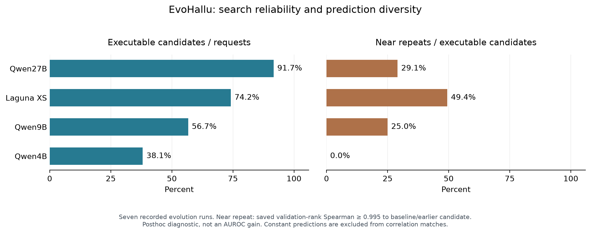

# EvoHallu: Evolution Process Tuning

Research date: 21 October 2026. Scope: improve the quality and efficiency of future detector searches using the existing code, saved histories, and primary research papers.

**Current setup and reporting clarification:** [NEXT_EXPERIMENTS.md](NEXT_EXPERIMENTS.md) maps the earlier user checklist to prepared studies. The author clarified per-dataset `max(AUC, 100-AUC)` reporting: NLL is 65.64 directed / 68.71 paper-compatible, so the baseline discrepancy is resolved. The mechanism proposals below remain research designs; only the explicitly listed next-study configurations have been implemented.

**Recommendation:** first improve executable-candidate yield, prediction diversity, and parent selection. Then compare continuation against restarts at equal total budgets. The current evidence does not justify assuming that a single much longer run will outperform these changes.

**Status:** the new measurements below are CPU-only audits of existing records. No GPU was started, no model was queried, and no generated candidate was re-executed. No tuned search has yet established an AUROC improvement. Keep the primary `is_hallu` labels and the historical Sequence NLL baseline of **65.64 macro AUROC**.

## 1. New evidence from our actual searches

The audit replays all **201 rounds from seven primary evolution runs**, matching every saved prompt and island choice. It examines all **402 requests and 283 valid candidates**, including their saved PopQA validation predictions. Source: [evolution_tuning_audit.json](results/evolution_tuning_audit.json); reproduction script: [research_evolution_tuning.py](scripts/research_evolution_tuning.py).

| Writer | Valid / requested | Valid rate | Valid candidates close to an earlier prediction¹ | Main invalidity pattern |
| --- | ---: | ---: | ---: | --- |
| Qwen3.8-27B | 110 / 120 | 91.7% | 29.1% | Numerical failures; relatively few invalid programs |
| Laguna XS 2.1 | 89 / 120 | 74.2% | 49.4% | 22 of 31 failures were numerical/dtype related |
| Qwen3.5-9B | 68 / 120 | 56.7% | 25.0% | 39 of 52 failures involved shapes or indexing |
| Qwen3.5-4B | 16 / 42 | 38.1% | 0.0%² | Shapes/indexing and evaluator-interface failures |

¹ For each valid candidate, its saved validation-score ranking is compared with the initial NLL and all earlier valid candidates from the same run. A near repeat has positive Spearman correlation **≥0.995** with at least one previous ranking. This is a nearest-previous statistic, not the fraction of all correlated pairs. It does not prove functional equivalence or that the candidate is useless. Future search-time novelty must be computed on training/probe predictions, not these validation vectors.

² Constant-score vectors are counted separately; their correlation is undefined. An exact repeated constant ranking can therefore exist without contributing to the correlation-based near-repeat count.



### Parent selection is weakly fitness-weighted after filtering

The current database clusters programs by equal training AUROC. It first applies a percentile gate, then samples score groups with `softmax(train_auc_percent / 40)`.

- The percentile filter was active in **129 / 201 rounds**, so selection overall is not uniform.
- Among the **180 rounds with multiple eligible groups**, the median relative effective sample size was **0.9984**. Here `relative_ESS = 1 / (N * sum(p_i²))`; uniform sampling gives 1.
- The median ratio of largest to smallest eligible-group probability was only **1.105**. Thus the softmax usually adds little preference within the filtered subset.
- In **18 rounds**, an island had at least five score groups but the percentile filter was skipped because too few groups remained strictly above its threshold. This permits broader sampling again even when the nominal percentile has narrowed.

These are implementation diagnostics, not proof that a lower temperature improves generalization. Excessively greedy training selection can also be harmful: in two primary runs, the final validation winner had lower training AUROC than the maximum-training-AUROC candidate.

### More rounds help some writers, not uniformly

| Run | Best validation after 10 rounds | After 20 | After 30 | Selected round |
| --- | ---: | ---: | ---: | ---: |
| Qwen27B, seed 1047 | 79.6135 | 79.6135 | 79.6135 | 5 |
| Qwen27B, seed 1048 | 78.4723 | 78.7667 | 78.7667 | 14 |
| Laguna, seed 1047 | 76.3542 | 78.7735 | 79.2575 | 28 |
| Laguna, seed 1048 | 76.0611 | 78.7667 | 79.5008 | 28 |
| Qwen9B, seed 1047 | 76.4304 | 77.8208 | 77.8208 | 12 |
| Qwen9B, seed 1048 | 76.8433 | 79.5752 | 79.5752 | 16 |

These observed prefixes do not predict what a 500-round run would produce. They support a controlled continuation/restart comparison. In particular, a universal early-stop rule would have missed Laguna's improvements near round 28.

### Existing baselines already provide a useful quality target

The primary Qwen27B detector scores **69.80**, while the existing fixed-14-feature logistic regression scores **70.28** on the same nine-dataset benchmark. Also, Qwen9B's fixed-example control scores **69.80**, versus **69.54** for its matched evolution seed. Better selection and feature combinations are plausible opportunities; evolutionary feedback itself is not guaranteed to help.

The separate 50-seed CPU coefficient-search study found a mean source-validation advantage of **0.518 percentage points** for its evolutionary search over independent coefficients, with paired-seed interval **0.212–0.840**. That restricted result does not establish a comparable benefit for LLM program evolution or held-out macro AUROC.

## 2. What the literature contributes

These mechanisms were demonstrated on other tasks. Their transfer to hallucination detection is a hypothesis to test.

| Primary source | Relevant mechanism | Adaptation worth testing here |
| --- | --- | --- |
| [ShinkaEvolve, §3 and §5](https://arxiv.org/html/2509.19349v1) | Rank-based or performance/offspring-count parent sampling; novelty filtering; mutation operators | Replace scale-sensitive sampling, reduce repeated archive entries, and maintain exploration. Use inexpensive prediction behaviour available from our caches rather than adding an LLM novelty judge. |
| [AlphaEvolve, §2.3–2.4](https://arxiv.org/html/2506.13131v1) | Targeted code edits and evaluation cascades | Evolve a scoring function inside a fixed wrapper; run contract/smoke checks before full scoring. |
| [ReEvo, §4](https://arxiv.org/html/2402.01145) | Comparative reflections, crossover, and accumulated short textual lessons | Return training-only failure diagnostics and concise comparisons between better/worse parents. Charge reflection calls to the search budget. |
| [Evolution of Heuristics, §3](https://proceedings.mlr.press/v235/liu24bs.html) | Evolve a short idea description together with code, using several variation strategies | Require a brief feature hypothesis and distinguish coefficient changes, structural mutations, and new-family proposals. |

We should not interpret these papers as evidence for a specific AUROC gain on EvoHallu. A complete migration to another framework is unnecessary for the first experiments.

## 3. Highest-priority changes

### P1. Make the mutable program small and the interface reliable

**Why first:** Qwen9B loses 43.3% of its primary requests to invalidity; its most common failure is shape/index misuse. Laguna's failure pattern points to unstable numerical operations. Improving validity increases the number of usable proposals within the same request budget.

Proposed implementation:

1. Keep `Estimator` inheritance, batching, dependencies, and result-shape validation in an immutable wrapper. Ask the writer to implement only a per-claim scoring function.
2. Give explicit array shapes, token-position semantics, stable numerical helpers, and short/constant-sequence examples. Convert working arrays to float64 for sensitive arithmetic while preserving the cached source arrays.
3. Add a cheap smoke suite covering very short claims, constant log-probabilities, finite extremes, and top-k inputs. Then perform full training evaluation. Correctness failures can be rejected early; do not initially prune by small-sample AUROC, which may discard useful ideas.
4. Permit at most one repair attempt for a failed proposal, with the exception and a minimal failing training example. Include every repair request and its tokens in the fixed budget.
5. Keep API/serving failures separate from candidate failures. Replace the three-failed-round model shutdown with a bounded repair/recovery policy; retain a separate endpoint watchdog.

**Important alignment detail:** the current extraction code computes `sequence_logprobs[t]` from `logits[t]` and `input_ids[t+1]`. The last top-k row has no matching observed-token likelihood. In the raw full-sequence representation, `top_k_logits[:-1]` aligns with the sequence likelihoods. This does not justify arbitrary padding or truncation after other transformations. Verify alignment with deterministic fixtures before exposing an aligned view. Keep claim-only versus template-inclusive scoring as a separate ablation.

Do not hide bugs by automatically applying `nan_to_num` to arbitrary outputs or by falling back to NLL for every exception. Report validity and genuine repairs explicitly.

**Provisional engineering target:** at least 85% valid Qwen9B candidates. At 60 requests, 85% would yield 51 valid candidates rather than approximately 34 at the observed rate. This is a target, not a measured improvement, and more valid candidates do not guarantee higher AUROC.

### P2. Maintain an archive of behaviourally different candidates

**Why:** text SHA deduplication found no exact-source repeats in the recorded LLM runs, yet many candidates had almost identical prediction rankings. Different source code is not sufficient evidence of a different detector.

Proposed archive:

- Retain all candidate records, but use a smaller parent archive with quality elites and a novelty reserve. Start with approximately 8–16 entries per island and keep two islands for a 60-request search.
- Save predictions on a fixed, stratified **training probe** of approximately 512 claims. Compute exact rank fingerprints and nearest positive Spearman correlation.
- When a new candidate closely matches an archived behaviour, retain the better-training-quality representative. Keep a genuine improvement even if it is very similar. A threshold of 0.995 is a starting hypothesis, not a universal definition of duplication.
- Sample the first parent for quality and a second parent for complementary behaviour, while retaining some random exploration. Preserve occasional lower-fitness stepping stones rather than requiring every parent to beat NLL.
- Store parent hashes, behaviour descriptors, and operator names in the ledger.

This should improve the material shown to future generations. It cannot recover tokens already spent generating a duplicate. Code-level novelty checks before execution may save CPU, but the main expected benefit here is better subsequent proposals.

### P3. Use scale-independent, moderate selection pressure

Test rank-based sampling inside the same eligible subset before combining it with a different percentile rule:

```text
rank 1 = best training fitness
q_i ∝ rank_i^(-alpha)
p_i = (1 - epsilon) * q_i + epsilon / N
starting settings: alpha = 1, epsilon = 0.2
```

The mixture is our proposed adaptation. It keeps exploration and avoids interpreting the arbitrary 0–100 AUROC scale as a useful sampling temperature. Compare `alpha=0.5` and `alpha=1` in a small subsequent sensitivity check; `alpha=2` is a stronger-exploitation alternative, not the default recommendation. The audit JSON includes counterfactual probability distributions for these values, **not counterfactual quality results**.

Separately test an explicit top-K gate:

```text
K = min(number_of_groups,
        max(number_of_parents, ceil(percentile * number_of_groups)))
```

Take the top K score groups instead of reverting to the full island when the strict quantile threshold leaves too few groups. Keep this as a distinct ablation: changing both the gate and rank sampling at once would not isolate either effect.

Avoid deterministic best-only selection. The saved runs show train/validation disagreement, and some useful parent lineages may initially have weaker training fitness.

### P4. Make exploration and exploitation explicit

**Follow-up audit:** [PROMPT_DIVERSITY_AUDIT.md](PROMPT_DIVERSITY_AUDIT.md) inspects the actual baseline-plus-signal instructions and saved sibling outputs. Near-identical prediction rankings occur in 22/111 valid sibling pairs (19.8%), versus 41/768 nearby-round pairs (5.3%). This supports testing prompt anchoring separately from parent selection; it is observational evidence, not a measured benefit of changing prompts.

After P1–P3, test an operator mixture such as **50% local edits, 25% crossover, 25% new-family proposals**. These are provisional starting proportions, not established optima.

- Local edits: change a coefficient, quantile, positional weighting, or aggregation rule without rewriting all boilerplate.
- Crossover: combine complementary parents, asking for a single justified combination rather than unrestricted feature accumulation.
- New-family proposals: generate a short hypothesis followed by code, covering local surprisal runs, confidence gaps, distribution shape, or position/length effects.
- Training feedback: include the parent score, improvement relative to that parent, finite-output failures, and summaries by training subgroup. Keep validation metrics out of mutation prompts and adaptive operator rewards.

Use a small fixed operator mixture before introducing a bandit. Sixty requests provide limited evidence for learning many operator/model probabilities. One local writer avoids model-swapping overhead on a single GPU; adaptive model ensembles are lower priority under the current hardware/API constraints.

### P5. Improve final candidate curation and separate numerical fitting

The [EvoHallu paper's](https://aclanthology.org/2026.acl-srw.115.pdf) top-candidate collection differs from our single-winner output. For the next study:

1. Preserve a top-three shortlist per run by validation, with a separate diversity-aware collection for inspection.
2. Inspect actual executable formulas for unused branches, constant features, invalid probability normalization, and template dependence. Treat generated comments as hypotheses.
3. Keep a single predeclared validation-selection rule for the primary detector. Do not select the best of this collection on the nine test scores.
4. Explore a second track where the writer proposes features/formula structure and a CPU optimizer fits a small number of coefficients on training data. The existing logistic/QDA controls show why this is worth comparing.

For that second track, tune fitted coefficients only inside training folds, then select on outer validation. Compare against the fixed-feature logistic baseline and a coefficient-only search with the same features. Label it as a fitted/supervised extension; it is a different intervention from population tuning and does not involve fine-tuning Llama or the writer.

## 4. Fitness and validation must measure real quality

The objective is better detector AUROC, not merely more executable code or higher training fitness.

- Keep `is_hallu` and freeze preprocessing for a given comparison. Recheck the NLL baseline when modifying wrappers, precision, or token views; small numerical changes can alter rankings.
- Resolve normalized-claim overlap before a new split. The previous audit found 88 shared claims between train and validation, and 412 shared unique claims between PopQA train and PopQA test. Preserve the historical results separately.
- PopQA training metadata contain **16 property IDs and 6,412 subject IDs**. These support relation- or entity-aware diagnostics. Property-level AUC is meaningful only where both classes have adequate sample counts.
- Grouped evaluation and subgroup scores can expose brittle formulas, but do not automatically prevent adaptive overfitting. For a deterministic formula with no fitted parameters, averaging random-fold AUROCs is not independent out-of-sample training; it is another summary of the same scored examples.
- Reserve a confirmation partition from future search and hyperparameter decisions. A new split of already-used CSVs is not historically untouched data; a fully independent confirmation claim needs additional unseen claims/datasets.
- Freeze selected programs before nine-dataset scoring. Those nine datasets have already informed exploratory analysis, so further gains on them remain exploratory until independently confirmed.

## 5. Controlled experiment plan

Start with **Qwen3.5-9B**, because it is cheap enough for several seeds and its validity problems provide a measurable intervention target. Keep Llama3.1-8b-instruct as the fixed feature model.

### First screen: 720 writer requests

Use three fresh seeds per arm, **60 total requests per seed**, counting repairs and rejected proposals. Hold the split, initial NLL, raw feature caches, writer checkpoint, token cap, and final selection rule constant. Disable failure-based early termination for candidate errors in all arms; retain endpoint/resource limits. This common watchdog change means the new baseline is a prospective control, not an exact replay of the old early-stopping protocol.

| Arm | Configuration | Purpose |
| --- | --- | --- |
| A0 | Original class-generation/search interface, common fixed-budget watchdog | Prospective baseline |
| A1 | A0 + immutable wrapper, smoke checks, bounded repair | Isolate candidate reliability |
| A2 | A1 + behaviour-aware parent archive | Measure the additional archive effect |
| A3 | A2 + rank/uniform parent sampling, same percentile rule | Measure the additional sampling effect |

This cumulative design estimates each addition conditional on preceding changes. It does not prove that a component would help independently in every combination. Explicit mutation operators, percentile-gate repair, warm-start families, and coefficient fitting are subsequent ablations, rather than extra simultaneous changes to A3.

Report per-seed selected confirmation AUROC, validation AUROC, valid-candidate rate, distinct training-probe rankings, fraction of offspring improving on their parents, generation tokens, and wall time. Show both mean and dispersion across seeds. Three seeds are a screening minimum, not strong evidence for small improvements.

**Cost projection:** the two previous 60-request Qwen9B evolution runs took approximately 19–21 minutes each, including their recorded evaluation overhead. Twelve such runs imply roughly **4 hours** under similar conditions. A1 repair prompts and different archive contexts may change throughput. Allow approximately **5–6 hours** including smoke tests, serving, and evaluation; this is an estimate, not a resource reservation. Reusing valid archived features avoids another GPU feature-extraction pass.

If resources are tighter, run A0–A2 first: **540 requests**, approximately three hours at the old recorded rate, plus overhead. Do not interpret a screening success as a promised macro-AUROC gain.

### Second screen: continuation versus independent restarts

Compare **one 90-round search** with **three independent 30-round searches** at the same **180-request total budget**, repeated over several independent budget-level seeds. Select the restart portfolio's final candidate using the same validation rule.

Decouple the percentile schedule from `num_rounds`, or explicitly report the schedule change as part of the policy. The current `r / num_rounds` formula means that changing 30 to 90 rounds changes even the first 30 rounds; it is not an identical-prefix continuation. Do not change `num_rounds` on an old checkpoint and present that as a controlled continuation.

For low-diversity/stalled islands, test occasional reseeding while keeping the global best and all records. Current island resets are disabled. Trigger decisions should use training progress and training-probe novelty, not the nine test sets or repeatedly inspected validation gains.

### Final verification

Freeze the winning policy, run more seeds if the effect is small, then apply the fixed candidate-selection rule and score on the benchmark. Compare against newly run matched controls, NLL, the validation-selected supplied comparator, and the fixed-feature logistic baseline. Distinguish bootstrap uncertainty over claims from uncertainty over search seeds; neither replaces the other.

## 6. Code touchpoints for implementation

| Change | Primary location |
| --- | --- |
| Mutable scoring body, fixed class wrapper, repair prompts | `src/experiments/extension_trial.py` |
| Contract fixtures and prediction retention | `task_uncertainty_quantification.py`, `tests/test_extension_trial.py` |
| Rank sampling, behavioural archive, explicit gate, parent metadata | `src/packing/funsearch/programs_database.py` |
| Training-only subgroup feedback and hypothesis/operator prompts | `src/packing/model/prompt.py` and trial prompt construction |
| Fixed budget, repair counts, immutable resume parameters | Trial configuration and run-state validation |
| Confirmation selection and frozen evaluation | Separate search/evaluation scripts; preserve the nine-dataset boundary |

The research audit itself does not change these pipeline components. Proposed parameters require implementation and controlled runs before being treated as improvements.

## 7. Reproduce the new audit

Run from the repository root using the retained compact logs and source-validation prediction arrays:

```bash
PYTHONPATH=src:. OPENBLAS_NUM_THREADS=1 OMP_NUM_THREADS=1 \
  .venv/bin/python scripts/research_evolution_tuning.py
.venv/bin/python scripts/plot_evolution_tuning.py
```

This writes `results/evolution_tuning_audit.json`. It does not load raw feature caches, call a writer, score a new detector on test data, or allocate GPU inference. The novelty calculations are based on saved float32 validation predictions; treat them as diagnostics, not a replacement for training-time descriptors or a semantic-equivalence proof.

Additional local evidence: `results/search_budget_audit.json`, `results/campaign_summary.json`, `results/validation_controls/linear_seed_sweep.json`, `results/token_alignment_audit.json`, and the original candidate ledgers under `out/logs/mod1/`.
