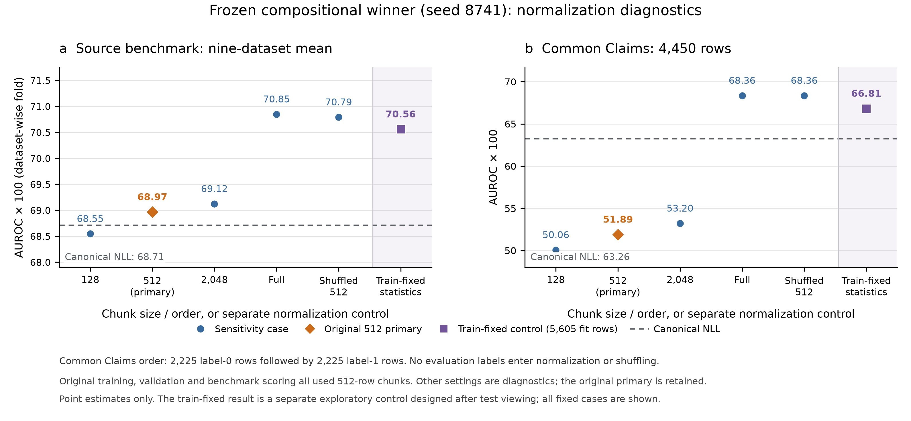
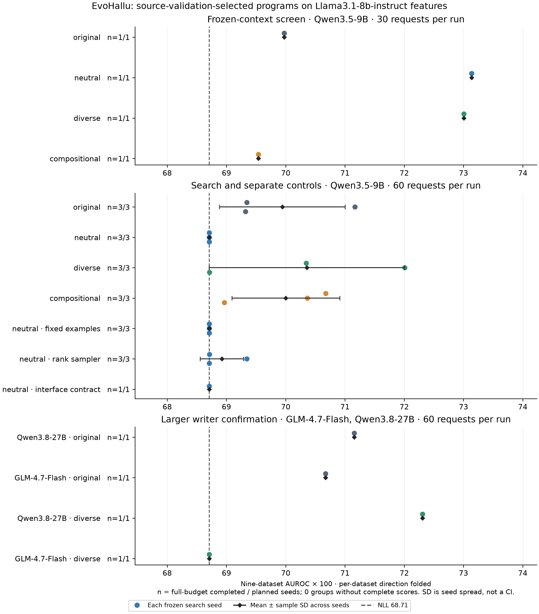

# evohallu preliminary report

**Completed 22 October 2026.** All writer searches, target-cache extraction, bounded CPU evaluations and verified backups are finished. One frozen target estimator failure is retained. RunPod confirmed the pod stopped at **00:44:41 UTC** with no GPU runtime; elapsed compute was **6 h 28 min, approximately $23.16**. This document supplements the [machine-generated source report](results/overnight20261021/REPORT.md); the historical report is preserved separately.

**Evolutionary results, without an additional supervised fit.** The validation-selected Qwen3.8-27B diverse-prompt detector reaches **72.306 paper-compatible AUROC** across nine source datasets, versus **68.711** for canonical sequence NLL. This is a single-seed, 30-round search. The paper's best displayed GPT-OSS-120B method scores **70.8**, and its best displayed Claude method scores **73.4**. Our 27B result is numerically above the former and below the latter; differing search budgets and candidate-selection procedures prevent a matched model-ranking claim. A separate fixed-context screen reaches **73.137**, using saved historical parents rather than a fresh adaptive trajectory. The campaign issued **1,500 requests across three writers**. The prompt comparisons do **not** establish a reliable diversity improvement; pipeline validity is not algorithmic novelty.

**Additional supervised fitting is reported separately below.** Its scores are excluded from the comparison of evolved formulas without a further fitted prediction layer. Evolution still uses training labels for fitness and PopQA validation for selection; “without an additional supervised fit” does not mean label-free search.

## Experimental scope and metric reproduction

[EvoHallu](https://aclanthology.org/2026.acl-srw.115.pdf) searches for executable hallucination scores: a code-writing model proposes Python estimators, their training AUROC supplies evolutionary fitness, and validation performance determines which programs are retained. The current source feature model is **Llama3.1-8b-instruct**. **Qwen/Qwen3.5-9B, Qwen3.8-27B and GLM-4.7-Flash are code writers** in the completed new studies. They write detector code; they do not generate new benchmark claims or replace Llama's cached token probabilities.

Inputs are the supplied **7,007 PopQA training rows** and nine evaluation datasets: PopQA, AVeriTeC, UHEAD, Cities, Companies, Common Claims, CounterFact, X-Fact and WildHallucinations. The estimators consume cached observed-token log-probabilities, top-512 logits/indices and supported uncertainty statistics. Variable-length arrays and the extra top-k row require explicit alignment. Top-512-normalized entropy and confidence are conditional approximations, and positional features include cached chat/template tokens; “late-token uncertainty” is therefore an approximate semantic interpretation.

The earlier **65 versus 68.7 discrepancy is resolved**. Labels remain **`is_hallu`**, with greater directed scores intended to indicate hallucination. The author's clarified reporting convention folds **each method–dataset AUROC** as `max(AUC, 100 − AUC)`, then averages the nine datasets equally. Canonical NLL reproduces **65.644 directed / 68.711 folded**, matching the paper's displayed **68.7**. Perplexity and mean token entropy also reproduce the displayed **64.2 / 59.9**. UHEAD's below-chance directed results do not imply incorrect labels.

Both summaries are retained. Folding uses evaluation labels to choose direction separately per dataset; it reproduces the reported metric, rather than supplying a deployment-time direction calibration. AUROC, ROC-AUC and AUC-ROC mean the same ranking metric here. All differences below are percentage points. See the [interpretation audit](results/overnight20261021/INTERPRETATION_CHECKLIST.md).

## Selection and controlled search design

The inherited evolutionary partition contains **5,605 training / 1,402 validation rows**. Directed training AUROC controls population fitness and parent selection. Valid candidates are evaluated on directed PopQA validation, and the run winner is its validation maximum, including **canonical-NLL fallback**. Benchmark and target-model scores do not choose the winner. All generation seeds are retained; incomplete-budget runs are excluded from primary group averages. A separately frozen training-best candidate is a selection diagnostic, not the primary result.

The completed main comparison has four policies across **three seeds, 60 requests each**. Thirty evolutionary rounds mean two attempted candidates per round, including failed or constant proposals. Neutral removes named formula prescriptions; diverse assigns different sibling roles/families; compositional encourages multiple signals without a feature-count ceiling. All twelve adaptive runs completed their budgets. Pipeline-valid means successful finite, correctly shaped scoring; it includes constant or baseline-equivalent programs and does not imply useful novelty. Values below are nine-dataset means; ± denotes sample SD across search seeds.

| Qwen3.5-9B arm | Seeds | Valid / requests | Directed mean | Folded mean ± seed SD |
| --- | ---: | ---: | ---: | ---: |
| Adaptive original | 3 | 101 / 180 | 67.823 | 69.943 ± 1.059 |
| Adaptive neutral | 3 | 98 / 180 | 65.644 | 68.711 ± 0.000 |
| Adaptive diverse | 3 | 103 / 180 | 67.748 | 70.355 ± 1.648 |
| Adaptive compositional | 3 | 78 / 180 | 68.297 | 70.002 ± 0.911 |
| Neutral fixed NLL examples | 3 | 88 / 180 | 65.644 | 68.711 ± 0.000 |
| Neutral rank/uniform parents | 3 | 100 / 180 | 65.864 | 68.922 ± 0.364 |
| Neutral interface-contract pilot | 1 | 29 / 60 | 65.644 | 68.711; SD unavailable |

Fixed examples and parent sampling are matched against **neutral evolution**, with the same writer, seeds and request budget. All three neutral adaptive and fixed-example winners are canonical NLL: the observed feedback difference is exactly **0.000 pp**. Rank/uniform adds **0.211 pp** on average, driven by one variance formula and one precision-only NLL variant. The single interface pilot retains NLL and has the same 29/60 validity as its matched neutral run. These null results concern the tested prompt/writer/budget, rather than evolution in general.

Diverse guidance exceeds original by **0.412 folded pp**, but is **0.075 directed pp lower**; compositional guidance adds only **0.059 folded pp**. Together with seed variation and the matched screen, these results do not establish that removing prompt restrictions improves useful diversity or quality. The separate training-only temporal diagnostic finds 11 novel-and-training-useful proposals for original, four for diverse, seven for compositional and zero for neutral across 180 attempts each. These are exploratory probe diagnostics, not held-out improvement counts. [Complete source trajectories](results/overnight20261021/convergence_analysis_source9b/CONVERGENCE.md).

The rank intervention mixes linear fitness-rank probabilities with **20% uniform probability over eligible groups**, preserving the existing quantile gate, island selection and within-group source preference. On the observed parent pools it actually concentrates selection more than the nearly flat original temperature-40 softmax; it is not evidence of increased exploration. The separate interface pilot appends the actual constructor/API, ragged-array shapes, alignment and score-direction contract, without repair calls or formula restrictions. Its motivation was training failure inspection, including **36 of 51 inspected failures involving shape/API issues**.

The additional validation-top-three study retains all **36 rank slots**, without choosing test-best candidates. All evaluation processes finished; **35/36 slots** have complete nine-dataset predictions. One rank-three original-policy program overflows its unscaled float32 `1.5**position` weights on WildHallucinations and X-Fact. Its missing metrics remain unavailable; no repair, replacement or failed-seed omission is used. Complete-policy top-three individual-AUROC collection means do not exceed their rank-one means. These are collections of individual methods, not ensembles. [Retained ranks and failure evidence](results/overnight20261021/shortlist_secondary/SHORTLIST_OUTCOME.md).

## Larger and different-family writer comparisons

The Qwen3.8-27B confirmation finished both original/diverse seed-2107 runs at **60 requests each**, using the same fixed source features and validation-selection rule. These are new full-budget writer runs, not historical results.

| Writer / prompt | Seeds | Valid / requests | Directed source-nine | Folded source-nine |
| --- | ---: | ---: | ---: | ---: |
| Qwen3.8-27B / original | 1 | 52 / 60 | 69.060 | 71.155 |
| Qwen3.8-27B / diverse | 1 | 56 / 60 | 70.297 | 72.306 |
| GLM-4.7-Flash / original | 1 | 28 / 60 | 68.533 | 70.671 |
| GLM-4.7-Flash / diverse | 1 | 36 / 60 | 65.644 | 68.711 |

The intervention policy was frozen by **mean PopQA validation over all three completed 9B seeds**, among neutral, diverse and compositional: 75.7504, 77.3867 and 77.2458 respectively. Thus diverse was selected. Original's 78.2091 was kept as the reference and excluded from intervention selection; diverse was not the overall validation winner. Neither nine-dataset nor target results chose the intervention.

The 27B original and diverse winners exceed the corresponding 9B seed-2107 folded scores by **1.811 and 1.961 pp**. Diverse exceeds original by **1.151 pp** in this one matched seed. This is encouraging writer evidence, not an estimate of a stable model-size or prompt-policy advantage. The original formula combines negative position/logprob correlation with centered-window relative drops; diverse implements quadratic later-position-weighted total NLL. Both use only observed-token logprobs, with no batch normalization or top-k term. [Exact sources and formulas](results/overnight20261021/WRITER27B_CANDIDATE_INSPECTION.md).

GLM-4.7-Flash completed the same original/diverse seed-2107 pair. Its original winner scores **70.671 folded**, but mathematically rediscovers the inherited negative Pearson correlation between token position and observed logprob. Its diverse winner is canonical NLL at **68.711**. More valid proposals under diverse guidance did not produce a better selected detector in this seed. These are not new multifeature discoveries; [selected-source inspection](results/overnight20261021/GLM_CANDIDATE_INSPECTION.md) distinguishes executable behavior from comments.

The measured GLM pilot left **65.54 minutes** before the writer cutoff; a second seed required **73.96 minutes**, and Devstral required **75 minutes**. Both were skipped by the fixed readiness/time gates. Devstral's checkpoint was prefetched, but no serving or quality trial ran. Scheduling used no benchmark-quality criterion. The first feature-extraction launch refused immediately after server cleanup because GPU telemetry was still active. After two verified idle snapshots with no GPU processes, a separate recorded recovery launched the **unchanged formal preparer and 427-row numerical guard**. The original refusal remains recorded; no threshold or estimator was repaired. The recovery completed all three caches; the separate nine-dataset evaluation and recorded failure are described below. [Recovery launch](results/overnight20261021/root_transfer_recovery_launch.json).

A separate fixed position/length diagnostic first reproduced the 27B quadratic winner, canonical NLL and row/mask arrays exactly on all **97,488 source rows**, then retained all four predefined controls. Uniform float32 mean NLL scores **64.176 folded**, normalized quadratic mean **70.724**, and the original accumulated quadratic sum **72.306**. Position emphasis therefore remains useful after unit-mass normalization in this comparison. Accumulation adds **1.582 folded pp [0.977, 2.277]**, but only **0.431 directed pp [−0.225, 1.102]**; UHEAD folding explains much of that distinction. Plain length scores **54.634 folded**, reproducing the old claim-length ordering: every source row has exactly 18 additional cached-LP positions. UHEAD and WildHallucinations regress versus NLL. These fixed contrasts are exploratory sensitivity tests, not a causal additive decomposition or a test-selected replacement. [All controls and independent verification](results/overnight20261021/position_length_controls/INTERPRETATION.md).

## Completed matched prompt screen

Four arms used the **same fifteen saved historical parent contexts**, two siblings each: **30 requests per arm, 120 total**. These are secondary, fixed-context experiments with inherited search information, not fresh adaptive searches or independent thirty-round trajectories. Each arm's winner was frozen by PopQA validation.

| Policy | Valid / attempted | Joint diverse sibling pairs / 15 contexts | Source-nine directed | Source-nine folded |
| --- | ---: | ---: | ---: | ---: |
| Original | 19 / 30 | 6 / 15 | 68.771 | 69.973 |
| Neutral | 19 / 30 | 4 / 15 | 70.848 | 73.137 |
| Diverse | 23 / 30 | 7 / 15 | 70.131 | 73.007 |
| Compositional | 11 / 30 | 3 / 15 | 67.465 | 69.538 |

The joint valid-and-rank-diverse diagnostic requires both siblings to be valid and nonconstant, with signed training-probe rank correlation below **0.995**, divided by **all fifteen contexts**. It does not additionally require training-fitness improvement. Every intervention-minus-original paired interval spans zero. Diverse guidance has the highest validity point estimate; compositional guidance has the lowest. Neither result proves a policy advantage from this small screen. Better validation quality is also insufficient: compositional validation is **80.286**, yet its folded benchmark score is **69.538**. The [paired analysis](results/overnight20261021/prompt_screen_analysis/PROMPT_SCREEN_ANALYSIS.md) retains failures, tokens, latency, hashes and diagnostic definitions.

## What the generated programs actually compute

Source inspection is necessary because comments and source length can overstate effective complexity. The neutral screen winner combines **total NLL, a position-weighted observed-versus-top-1 gap and final-quarter gap variance**, with writer-proposed coefficients. The diverse winner combines NLL, early/late gap drift and tail gap variance. The original screen winner is exactly **`[0.7*(-corr(position, lp)) + 0.3/(1+range(lp[last 10%]))] / (mean(abs(lp))+1e-8)`**: its slope-like term is a **negative Pearson correlation divided by mean absolute logprob**, not an ordinary regression slope. The compositional winner combines tail surprisal variance, tail mean and a positional correlation. These are small numerical formulas, not reconstructions of the unavailable Claude programs shown in the discussion. The original frozen [source](results/overnight20261021/frozen/next_prompt_original_2107__primary/frozen_estimator.py) has SHA256 `624e5d7457cff945b4a47b947309e7f84c499431ba134408595e265a435e69d0`.

The completed rank-sampler arm illustrates a more serious distinction. One selected program sorts each row ascending but reverses **rows**, then clips its first-minus-second-column difference at zero. Its purported gap term is identically zero for finite inputs: the executable score is **float32-summed NLL**. Its tiny validation improvement over canonical NLL is **0.0118 pp**, arising from a different summation precision and tie structure. A second seed selects NLL plus **0.5 × log-probability variance**; the third retains baseline NLL. Their folded mean is **68.922**, only **0.211 pp** above matched neutral.

Another inspected original-arm candidate contains an entropy branch that is inactive on all 7,007 source training rows. That is a verified source-data equivalence, not a proof that the branch is dead on every possible input. The [semantic audit](results/overnight20261021/semantic_rank_winner_audit.md) distinguishes mathematical identities, finite-precision differences and dataset-specific inactive branches. These findings prevent an apparent complex detector from being counted as a new multi-signal discovery.

Inspection of all twelve adaptive winners finds three NLL fallbacks, one float32-NLL variant, and eight nontrivial formulas involving thresholded surprisal, positional weighting/correlation, local variation or top-k contrasts. A compositional winner's claimed “bottom 10%” term actually takes the most confident log-probabilities. Its median/MAD normalization operates across the current sample batch. Exact formulas and caveats are in the [twelve-winner inspection](results/overnight20261021/ADAPTIVE_WINNER_INSPECTION.md).

## Batching and a train-only normalization control

The same frozen compositional seed-8741 program scores **68.965 folded AUROC** under the original 512-row convention. All original training, validation and benchmark paths use 512-row chunks. A separate five-case audit reproduces its nine original prediction vectors exactly before changing chunk size or row membership. Full-dataset calls give **70.847**, while a fixed label-independent shuffle at the same 512-row size gives **70.790**. These are sensitivity results, never replacement primaries. CommonClaims explains about **97%** of the full-batch macro change: its supplied rows form nearly class-pure chunks, and its score changes from **51.890 to 68.357**. The other eight individual changes stay within about 0.21 pp. [Batch audit](results/overnight20261021/batch_sensitivity/INTERPRETATION.md).

A separately named control freezes the original four normalization medians/MADs using **only the original 5,605 PopQA training rows**, with no label-based coefficient fitting or new generation. It reaches **67.783 directed / 70.558 folded** and gives byte-identical scores under singleton, 128-row, 512-row and shuffled calls. The original zero-MAD rule automatically disables two terms; the feature calculations and writer-proposed coefficients remain fixed. CommonClaims drives the gain and four datasets worsen. This follow-up establishes batching stability for this control, not universal quality improvement; it was designed after test inspection and does not alter any primary result. [Fit and invariance evidence](results/overnight20261021/frozen_train_normalization/INTERPRETATION.md).

The same source-fixed control was first transferred without refitting to the six historical Llama3.2-1B datasets. It scores **65.844 directed / 69.491 folded**, versus original C8741 **64.110 / 67.130** and NLL **63.730 / 67.791**. Its target folded gain is **+2.361 [1.804, 2.975] pp** over the original and **+1.700 [1.320, 2.104] pp** over NLL. CommonClaims supplies about 80% of the gain over the original, and two datasets worsen. Absolute matched-six source-to-target quality falls **72.534 → 69.491**; the change in its NLL-relative advantage is **+0.171 [−0.135, 0.463] pp**, unresolved. All target batch/shuffle cases reproduce the same fixed predictions byte-for-byte. AUROC tests the frozen feature/scale combination; score-offset medians do not affect ranking, so it does not establish calibration transfer. This is a post-benchmark exploratory control, with no primary replacement. [Transfer protocol and independent audits](results/overnight20261021/normalization_transfer/INTERPRETATION.md).

The **completed nine-dataset normalization extension** reaches **63.564 directed / 66.584 folded** on the target, versus original C8741 **62.779 / 64.995** and NLL **61.459 / 64.835**. Folded gains are **+1.590 [1.133, 2.018] pp** over the original and **+1.750 [1.484, 2.034] pp** over NLL. The matched source-to-target loss is **3.974 pp**; its NLL-relative advantage changes **−0.098 [−0.320, +0.376] pp**, unresolved. Strict target-nine is **66.526**, versus NLL **64.781**. The first six predictions remain byte-identical; only CounterFact, PopQA and X-Fact were added. This establishes a retained ranking advantage and batching stability, not improved transfer robustness or uniform per-dataset improvement. [Full-nine interpretation](results/overnight20261021/normalization_transfer/NINE_INTERPRETATION.md).

## Fixed-coefficient component ablations

All four screen winners also received **eleven predefined fixed-coefficient component drops**. Full-program controls reproduce their original predictions exactly. Tail gap variance helps the neutral and diverse formulas; the diverse drift term contributes negligibly. The compositional tail-mean term is harmful with its fixed coefficient, whereas positional correlation carries much of that formula's useful ranking. These observations concern conditional contributions inside frozen formulas, not independent feature importance or a test-selected replacement detector. All drops, including negative results, remain in the [ablation report](results/overnight20261021/screen_component_ablations/ABLATION_REPORT.md).

## Separate exploratory experiment: supervised feature combinations

The following methods **fit numerical weights or distribution parameters to labelled PopQA training data**, in addition to selecting generated programs. They are supervised follow-ups, not results of evolution alone. Language-model weights are unchanged. Their source and transfer scores must not be used to claim that the unsupervised evolved formulas beat the paper.

The conventional controls use fourteen documented features and a separate **claim-grouped 5,606 / 1,401 split**. Three-fold grouped CV operates inside fitting rows only, with scaling inside each fold and five predefined regularization values. Heads are fitted on 5,606 rows and frozen without outer-validation refitting. This produces **73.019 logistic / 72.166 QDA folded AUROC**; it is supervised estimation, not supervised program evolution.

A separate CPU-only follow-up retains **all eleven full-minus-drop component vectors from all four winners**, plus an explicitly named **float64 total-NLL** column. One twelve-column logistic head is trained with the same grouped split, fit-only three-fold CV, scaler and five-value C grid; **C = 0.1** is selected. No feature is removed by benchmark quality, and weights are frozen for transfer. This is a learned combination of generated signals, not jointly supervised evolution.

| Completed scope | NLL directed | Head directed | NLL folded | Head folded | Folded gain |
| --- | ---: | ---: | ---: | ---: | ---: |
| Source Llama3.1, nine datasets | 65.644 | 71.359 | 68.711 | **73.633** | +4.922 |
| Target Llama3.2-1B, same nine | 61.459 | 66.552 | 64.835 | **68.800** | +3.965 |
| Source Llama3.1, matched six | 66.405 | 70.884 | 71.006 | 74.296 | +3.290 |
| Target Llama3.2-1B, same six | 63.730 | 68.060 | 67.791 | **71.431** | +3.640 |

The **complete nine-dataset head extension** scores **68.800 folded versus NLL 64.835**, a gain of **3.965 pp [3.529, 4.628]**. Its directed advantage is **5.092 pp**. Matched-nine target-minus-source head quality is **−4.834 pp [−5.270, −4.186]**; its NLL-relative advantage changes **−0.957 pp [−1.302, −0.149]**. Thus the advantage over NLL survives, but relative transfer is weaker over all nine datasets. The earlier matched-six gain-change interval spanning zero does not establish this full-nine result. Strict target-nine head/NLL scores are **68.731 / 64.781**. The extension reuses the original six results byte-for-byte, evaluates only three new datasets, and preserves the original report and frozen weights. [Separate nine-dataset report](results/overnight20261021/screen_component_refit/transfer_nine/TRANSFER9_REPORT.md).

The preserved six-dataset study gives a source-nine gain interval **[4.193, 5.419]** and target-six **[2.943, 4.280]**, from 500 claim-bootstrap replicates conditional on this frozen head. Absolute head performance drops **2.865 pp** on matched six-dataset transfer. Its gain-over-NLL change is **+0.350 pp**, with interval **[−0.128, 0.842]**, so there is no clear relative-gain improvement. Source-nine and target-six means must not be compared directly. See the [refit report](results/overnight20261021/screen_component_refit/REFIT_REPORT.md).

| Frozen comparison | Source-nine folded | Target-nine folded | Completed target seeds |
| --- | ---: | ---: | ---: |
| Fourteen-feature logistic | 73.019 | 68.939 | One frozen fit |
| Fourteen-feature QDA | 72.166 | 64.386 | One frozen fit |

The component head exceeds logistic-14 by **0.614 source folded pp [0.022, 0.912]**, but its target folded difference is **−0.140 pp [−0.515, +0.458]**, unresolved. On directed target AUROC the head is **0.842 pp lower [−1.322, −0.342]**. This does not establish that generated components generalize better than the conventional feature set. [Paired comparison](results/overnight20261021/screen_component_refit/transfer_nine/HEAD_VS_LOGISTIC14_NINE.json).

For the component combination, the recorded CPU fitting stage took **122.7 seconds**. Fitting plus the initial source-nine and target-six evaluations took **17 minutes 49 seconds** elapsed, with the two evaluations running concurrently while writer searches continued. Later target-nine extension and audit work are additional; implementation/audit effort was not separately timed.

The component pool is **validation-informed** because its source programs were selected on PopQA validation before coefficient fitting. Its outer-validation **82.094** is diagnostic rather than independent validation. Benchmarks had also been viewed before this follow-up was designed, making its evaluation exploratory. Bootstrap intervals do not measure search-seed variability or correct multiple comparisons.

## Frozen transfer of evolved formulas

Transfer holds source-selected evolved formulas fixed and uses Llama3.2-1B features with the original shared tokenizer, verified row/token identities and no target fitting. All nine target caches are now complete, including **41,253 newly inferred rows**; all six historical cache hashes are unchanged. The formal mixed-runtime 427-row reference passed with exact identities/shapes/dtypes, **0.00390625** maximum token-logprob drift and NLL rank correlation **0.9999998844**. This coarse numerical guard does not establish bitwise feature equivalence across runtimes. The complete evaluation executed all **18 dataset/kind tasks**. **29 of 30 main method identities** have full-nine results. This execution total includes the two supervised controls reported separately; the evolved-formula table below excludes them. Compositional seed **2107** has only eight: its target UHEAD output fails the finite/shape check. Saved warnings and source suggest float16 entropy underflow (`0*log(0)` after `1e-10` rounds to zero); this is a static/log-supported diagnosis, without new reproduction or repair. No replacement or complete three-seed compositional target mean is reported. The successful two seeds remain individual results, not a complete primary cohort.

| Frozen comparison | Source-nine folded | Target-nine folded | Completed target seeds |
| --- | ---: | ---: | ---: |
| Canonical NLL | 68.711 | 64.835 | Fixed baseline |
| 9B adaptive original | 69.943 ± 1.059 | 66.591 ± 1.135 | 3/3 |
| 9B adaptive diverse | 70.355 ± 1.648 | 66.132 ± 1.211 | 3/3 |
| 9B adaptive compositional | 70.002 ± 0.911 | Incomplete cohort | 2/3 |
| 9B neutral / fixed-example neutral | 68.711 / 68.711 | 64.835 / 64.835 | 3/3 each |
| 9B neutral rank/uniform | 68.922 ± 0.364 | 65.032 ± 0.343 | 3/3 |
| Qwen27B original | 71.155 | 67.471 | 1/1 |
| Qwen27B diverse | 72.306 | 67.780 | 1/1 |
| GLM original | 70.671 | 67.219 | 1/1 |
| GLM diverse | 68.711 | 64.835 | 1/1 |

The diverse-versus-original point ordering reverses for the 9B adaptive means on target features. Fixed-example versus adaptive neutral remains exactly zero. The one-seed 27B and GLM results remain descriptive. [All method identities, per-dataset failures and paired intervals](results/overnight20261021/transfer_llama32_1b/d00b4c0d58d795bf/TRANSFER_REPORT.md).

All four full screen formulas also lose **1.06–3.56 pp on matched six**, and **2.29–4.72 pp on matched nine**. Source-nine and target-six means must not be compared directly.

## Interpretation limits and comparison with the paper

Exact normalized-claim grouping prevents fitting/validation overlap for the fitted heads. The inherited evolutionary split nevertheless has **88 shared normalized claims**. The test collection also includes **520 PopQA rows** matching the full training CSV, plus **six WildHallucinations rows and one Cities row**. The duplicate-disjoint folded macro is **72.949** for the fourteen-feature logistic and **73.570** for the component head. Small macro reductions do not establish semantic-, entity- or relation-disjoint generalization.

The paper displays **70.8** for its best shown GPT-OSS-120B method and **73.4** for its best shown Claude method. Both are evolved formulas evaluated on Llama3.1-8B-Instruct features. Our Qwen27B detector scores **72.306** without an additional fitted layer: about **1.51 pp above** the displayed GPT-OSS result and **1.09 pp below** the Claude result. The separate historical-context screen reaches **73.137**, also below 73.4. These are numerical comparisons, not matched replications. The paper typically uses **500 rounds with two proposals**, multiple runs and retained collections; our full adaptive trajectories use **30 rounds with two proposals**. There is no paired evaluation of the original paper executables here. The supervised combination belongs to the separate experiment above and is excluded from this evolutionary comparison. These results do not establish that we beat the paper's best method.

## Coverage, implementation and remaining deliverables

| Original extension question | Completed evidence | Remaining scope |
| --- | --- | --- |
| Newer/smaller writers | Pinned 9B screens, four-policy/three-seed adaptive matrix and controls; complete 27B and GLM original/diverse pairs | Devstral time-skipped; matched GPT-OSS cost comparison absent |
| Diversity and structured generation | Four matched policies, validity and rank diagnostics | No reliable diversity gain; sketch-then-code, repair and novelty archive untested |
| Claude complexity and writer differences | Executable local formulas, failures and dead-term audit | Original Claude populations unavailable; Sonnet/Opus ranking unexplained |
| Supervised estimators | Grouped logistic/QDA and exploratory component head | Joint supervised evolution untested |
| Necessity of feedback | Three complete matched neutral/fixed-example seeds; all six winners retain NLL and the quality difference is zero | Long-run/restart comparison and fresh no-example arm untested |
| Feature-model transfer | Full-nine frozen comparison, one retained method failure; separate complete head/normalization studies | Native-tokenizer transfer and independent confirmation untested |
| Component importance | All eleven drops and all-column refit | Original paper-formula ablations, Shapley and exhaustive subset frontier untested |

The [coverage audit](results/overnight20261021/extension_coverage_audit.md) maps these questions to the original proposal. Code changes provide opt-in trials, prompt policies, saved predictions/provenance, unique frozen estimators, cached evaluation, fitted controls and reproducible reporting. During execution, pinned search/core bytes remain fixed; additive wrappers apply the declared sampler and interface hooks. This does not mean the repository is unchanged from the supplied archive. Scheduling reservations allow the same feedback jobs to overlap safely without duplicate requests or altered experimental identities.

The completed Qwen9B phase issued **1,260 requests across 23 full-budget jobs**, with **669 valid candidates**, including the screens, adaptive matrix, feedback controls, sampler controls and one interface pilot. The completed Qwen27B pair adds **120 requests / 108 valid candidates**. GLM adds **120 requests / 64 valid candidates**, bringing the complete campaign to **27 jobs / 1,500 requests / 841 pipeline-valid candidates**. Recorded usage totals **1,889,962 prompt + 2,204,266 completion = 4,094,228 tokens**; two requests lack token usage. These are persisted local-server usage counts, not paid API charges. The **two A100-SXM4-80GB** pod cost **$3.58/hour total**. From **21 October 18:16:28** through confirmed shutdown **22 October 00:44:41 UTC**, elapsed compute is **6 h 28 min / approximately $23.16**, excluding storage/network and pre-task waiting; it is an estimate rather than an invoice. Summed overlapping request latencies are not GPU-hours. Telemetry samples approximately once a minute and does not certify continuous busy time. [Resource accounting](results/overnight20261021/resource_summary/RESOURCE_USAGE.md).

All **three new XZ archives**, totaling **762,346,556 bytes**, passed remote lossless raw-SHA round trips and local compressed-SHA verification. **5,889 unchanged scientific artifacts** match the pod snapshot locally. The pre-publication backup verified 5,890 files; mutable progress and the plotting receipt regenerated offline are explicitly excluded from the final scientific scope. RunPod confirms **`EXITED` and `runtime: null`**. [Backup verification](results/overnight20261021/final_local_backup_validation.json), [cache backup](results/overnight20261021/cache_backup_receipt.json), [stop confirmation](results/overnight20261021/pod_stop_confirmation.json).

The code changes are described in [the implementation audit](results/overnight20261021/CODE_CHANGES_20261021.md). The working GPU environment passed dependency checks and real model/numerical-reference execution; a second clean rebuild remains unperformed. Historical reports and pinned six-dataset studies are preserved separately. The source figure below retains every generation seed; its bars describe seed spread, not confidence intervals or a winner chosen on test quality.

